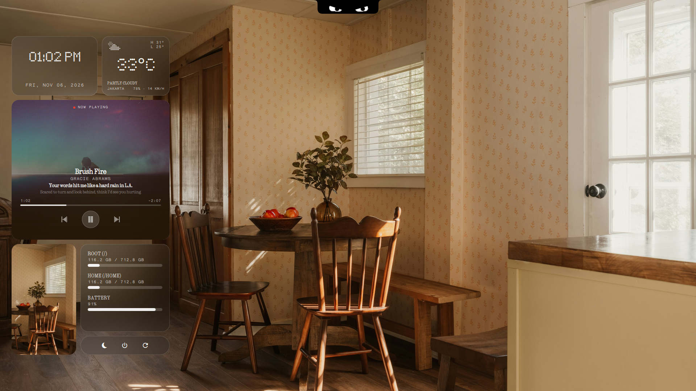

<p align="center">
  <h1 align="center">GLYPH-SHELL</h1>
  <p align="center">
    <strong>Nothing OS 3.0 Dot-Matrix & Chameleon Frosted Glass Desktop Shell Suite for Hyprland</strong>
  </p>
  <p align="center">
    <a href="https://quickshell.outfoxxed.me/"></a>
    <a href="https://hyprland.org/"></a>
    <a href="https://nothing.tech/"></a>
    <a href="https://lrclib.net/"></a>
  </p>
</p>

---

## 🌟 Tentang glyph-shell

**`glyph-shell`** adalah *desktop shell suite* modern, elegan, dan kaya fitur yang dirancang khusus untuk ekosistem Wayland / Hyprland. Terinspirasi dari filosofi desain perangkat keras dan perangkat lunak **Nothing OS 3.0**, proyek ini menggabungkan estetika **Tipografi Dot-Matrix**, **Chameleon Frosted Glass** (GPU Dual-Kawase blur yang warnanya mengekstrak secara cerdas dari wallpaper dan cover album), serta komponen interaktif yang saling terintegrasi penuh tanpa memerlukan status bar konvensional (Waybar).

Dibangun secara native menggunakan framework **[Quickshell](https://quickshell.outfoxxed.me/) (Qt6 / QML)** dengan dukungan background daemon Python yang sangat ringan, hemat baterai, dan responsif.

<p align="center">
  
</p>

---

## 🏛️ Arsitektur & Fitur Utama

```text
                               ┌────────────────────────────────────────────────┐
                               │   TOP NOTCH & DYNAMIC ISLAND STATUS (notch/)   │
                               └──────────────────────┬─────────────────────────┘
                                                      │
         ┌────────────────────────────────────────────┼────────────────────────────────────────┐
         │                                            │                                        │
┌────────▼─────────────────────────┐   ┌──────────────▼────────────────────┐   ┌───────────────▼────────────────────────┐
│  DESKTOP BENTO GRID (widgets/)   │   │ UNIFIED APP LAUNCHER (launcher/)  │   │  NOTIF & SIDEBAR (notifications/side/) │
│  • Nothing Dot-Matrix Clock      │   │ • 2D Icon Grid Matrix (4-Arah)    │   │  • Native D-Bus Frosted Notif Server   │
│  • Weather & IP Geolocation      │   │ • Smart App Fuzzy Search          │   │  • Shutter Sound Screenshot Suppress   │
│  • AutoMix Player + Synced Lyric │   │ • Instant Antigravity IDE Folder  │   │  • Slide-Out Music & Multi-Player      │
│  • Circular Ring Gauges (Gauges) │   │ • Tab Mode: [ALL] [APP] [FOLDER]  │   │  • Live Notification History Drawer    │
│  • Power & Sleep Capsule         │   └───────────────────────────────────┘   └────────────────────────────────────────┘
└──────────────────────────────────┘                                                           │
         │                                                                                     │
         └────────────────────────────────────────────┬────────────────────────────────────────┘
                                                      │
                               ┌──────────────────────▼─────────────────────────┐
                               │   DOT-MATRIX LOCK SCREEN (lockscreen/hyprlock) │
                               │   • Native PAM hyprlock + Dynamic WP Blur      │
                               │   • Media Player Pill + Glyph Passcode Capsule │
                               └────────────────────────────────────────────────┘
```

---

### 1. 👁️ Interactive Top Notch & Dynamic Island (`notch/`)
* **Mata Pelacak Kursor Interaktif:** Sepasang mata putih bergaya *Angry Eyes* dengan paralaks 2-layer dinamis yang melacak pergerakan kursor mouse di seluruh layar lewat Hyprland IPC daemon (`cursor.py`), lengkap dengan kedipan acak (*random blinks*).
* **Hover-to-Peek Status Capsule:** Tempelkan kursor ke ujung atas tengah layar untuk menampilkan kapsul status (*Dynamic Island*) horizontal 3-segmen:
  1. 🔋 **Baterai:** Icon dinamis (`󰂄` saat charging / `󰁹` saat baterai) + persentase dot-matrix `Ndot57`.
  2. 🕒 **Jam & Tanggal:** Jam digital dot-matrix + tanggal ringkas monospace.
  3. 📶 **WiFi Aktif:** Icon dot-matrix + nama SSID aktif (`HANA`).
* **Low Battery Rage Mode ($\le 15\%$):** 
  * Saat baterai kritis dan belum dicolok charger, Notch otomatis turun ke layar (*force drop-down*).
  * Sepasang mata merah menyala bergetar marah (*rage vibration*), teks savage dot-matrix yang berganti tiap 4.5s (*"CHARGE YOUR FUCKING LAPTOP RIGHT NOW!"*), dan animasi colokan yang bergerak maju-mundur meminta dicolok.
  * Klik Notch sekali untuk *snooze* selama 4 menit jika sedang dalam keadaan darurat.
* **Charger Relief Mode (Saat Dicolok):**
  * Begitu charger dicolok, Notch berubah menjadi hijau segar (`#30D158`), mata tersenyum lega (`^  ^`), teks adem (*"AHHH LEGA... SWEET ELECTRICITY ⚡"*), dan colokan nancep rapat dengan kilat `⚡` sebelum kembali sembunyi mulus.
* **Nothing OS Volume & Brightness HUD OSD:** Notch bermorfosis menjadi indikator volume/kecerahan dot-matrix saat tombol multimedia ditekan atau saat di-scroll langsung di atas notch.
* **WiFi Network Manager Popover (`Super + W`):** Menu koneksi WiFi bergaya dot-matrix dengan kekuatan sinyal bertingkat, inline password input, dan toggle ON/OFF.
* **Bluetooth Manager Popover (`Ctrl + Super + B`):** Menu Bluetooth native berbasis **BlueZ (`bluetoothctl`)** tanpa ketergantungan `blueman-manager`, menampilkan perangkat TWS/audio/input tersimpan dengan *1-click connect/disconnect*, indikator persentase baterai TWS, tombol scan perangkat sekitar, dan saklar power Bluetooth ON/OFF.
* **Display / HDMI Projection Menu (`Super + P`):** Pengalih mode multi-monitor instan (PC Only, Duplicate, Extend, Second Screen) menggunakan perintah native Hyprland.

---

### 2. 🍱 Desktop Bento Grid Widgets (`widgets/`)
* **Jam & Tanggal Digital Nothing OS:** Jam digital besar menggunakan font resmi `Ndot57` dan tanggal monospace `LetteraMonoLL`.
* **Kartu Cuaca & Lokasi Real-Time:** Icon cuaca dot-matrix, suhu tertinggi/terendah harian, suhu besar `Ndot55`, kondisi cuaca, serta deteksi lokasi otomatis berdasarkan IP publik dengan cache lokal 15 menit.
* **AutoMix BitChord Media Player:**
  * **Cover Bleed ke Blurred Glass:** Cover album bertransisi mulus (*smoothstep S-curve opacity mask*) ke frosted glass di bawahnya.
  * **Ambient Glass Color Wash:** Latar belakang kaca mengekstrak warna dominan bagian bawah cover album lagu yang sedang diputar.
  * **Lirik Tersinkronisasi Real-Time:** Mengambil lirik sinkron dari [LRCLIB](https://lrclib.net/) berdasarkan posisi pemutaran `playerctl` dengan baris aktif yang disorot otomatis.
* **Circular Ring Gauges (Grid 2x2):**
  * Menggantikan bar garis konvensional dengan 4 cincin melingkar (*circular gauges*) bergaya iOS/macOS:
    1. 💻 **BATTERY:** Persentase baterai laptop + icon dinamis (hijau / merah saat kritis).
    2. 🧠 **RAM / MEMORY:** Persentase dan jumlah pemakaian RAM real-time dari `/proc/meminfo`.
    3. 💾 **ROOT (`/`):** Kapasitas dan pemakaian partisi sistem Linux.
    4. 📁 **HOME (`/home`):** Kapasitas dan pemakaian partisi user.
* **Poster Frame Estetik:** Frame foto portrait 20px dengan *auto-reload* otomatis saat file [`assets/poster.jpg`](assets/poster.jpg) diganti.
* **Kapsul Kontrol Daya:** Tombol cepat untuk *Lock Screen* (`󰌾`), *Sleep/Suspend* (`󰤄`), *Power Off* (`󰐥`), dan *Reboot* (`󰑐`).

---

### 3. 🔔 Chameleon Notification Server (`notifications/`)
* Menggantikan daemon eksternal (seperti `dunst`, `mako`, atau `swaync`) melalui interface D-Bus `org.freedesktop.Notifications`.
* Kartu notifikasi floating dengan sudut membulat 20px, highlight tepi kaca, dan GPU Dual-Kawase blur.
* **Filter Khusus Screenshot:** Hasil tangkapan layar tidak menampilkan popup notifikasi, melainkan langsung memutar efek suara *shutter* kamera bawaan GNOME (*cekrek*) via PipeWire (`pw-play`).
* **Suppress Notif Baterai Sistem:** Notifikasi baterai bawaan otomatis diredam karena sudah ditangani secara interaktif oleh Notch Rage & Relief Mode.
* **Aksi Pintar Antigravity IDE:** Menampilkan tombol cepat interaktif untuk berpindah workspace ke Antigravity IDE saat ada prompt permission atau input.

---

### 4. 🎛️ Music Sidebar & Notification History Drawer (`sidebar/`)
* Dibuka/tutup dengan shortcut **`Ctrl + Super + S`** atau klik tombol di widget.
* **Multi-Player Switcher:** Beralih antar pemutar musik (Spotify, YouTube di Brave/Firefox/Chrome, VLC) secara instan.
* **My Playlist Drawer:** Simpan lagu favorit ke playlist lokal, langsung diputar via Spotify D-Bus (`org.mpris.MediaPlayer2.Player.OpenUri`).
* **Live Notification History:** Bagian bawah sidebar menampung seluruh riwayat notifikasi masuk yang dapat dihapus per item (`✕`) atau sekaligus (`CLEAR ALL`).

---

### 5. 🔒 Nothing OS Dot-Matrix Lock Screen (`lockscreen/`)
* Menggantikan lockscreen bawaan dengan engine native **`hyprlock` (v0.9.6)** yang aman dan hemat daya.
* **Dynamic Desktop Wallpaper Blur:** Script [`lockscreen/lock.sh`](lockscreen/lock.sh) mendeteksi wallpaper aktif lo saat itu untuk efek *deep Dual-Kawase blur* (`blur_passes = 4`, `blur_size = 8`).
* **Top Status Header:** Menampilkan `[:::] WIFI · <SSID>` di kiri atas dan `BAT XX% [●●●○○]` di kanan atas.
* **Hero Clock & Weather:** Jam raksasa dengan font resmi `Ndot 57` dan baris tanggal/cuaca dari cache lokal.
* **Interactive Media Pill:** Menampilkan judul lagu, artis, serta tombol klik `[ |◁ PREV ]`, `[ ⏸ PAUSE ]`, dan `[ NEXT ▷| ]`.
* **Glyph Passcode Capsule:** Input password kapsul kaca gelap dengan placeholder `ENTER PASSCODE` (tanpa teks fingerprint), titik password dot-matrix, dan fail state merah Nothing OS (`#D71921` — `ACCESS DENIED`).

---

### 6. 🚀 Unified App & IDE Project Launcher (`launcher/`)
* Dibuka/tutup dengan shortcut **`Ctrl + Super + Enter`**.
* **Unified Smart Search (Opsi B):** Satu kolom pencarian cerdas untuk mencari **Aplikasi Desktop** sekaligus **Folder Project / Repo Git**.
* **Open Folder in Antigravity IDE:** Memilih folder project (berbadge merah `IDE`) dan menekan `Enter` akan langsung membuka folder tersebut di **Antigravity IDE** (`/opt/antigravity/antigravity-ide <path>`).
* **Layout Grid 2D (5 Kolom):** Icon besar dengan nama ringkas, mendukung navigasi keyboard 4 arah penuh (**`←`**, **`→`**, **`↑`**, **`↓`**), dan tombol **`Tab`** untuk beralih filter `[ALL]`, `[APPS]`, dan `[FOLDERS]`.

---

### 7. 🖼️ Native Wallpaper Carousel (`wallpaper/`)
* Dibuka/tutup dengan shortcut **`Ctrl + Super + W`** (dan **`Super + Shift + W`** untuk random wallpaper).
* **Bottom-Edge Horizontal Filmstrip:** Muncul mulus dari sisi bawah layar (bottom dock), membiarkan 85% layar tetap bersih agar lo bisa menikmati transisi wallpaper secara utuh.
* **Live Instant Preview (60fps):** Geser menggunakan tombol panah **`←`** / **`→`** (atau scroll mouse) dan wallpaper desktop langsung berubah secara *real-time* via `awww`. Jika menekan **`ESC`** atau klik di luar dock, wallpaper otomatis kembali ke wallpaper semula.
* **Dedicated Wallpaper Folder:** Mandiri penuh di `~/.config/quickshell/glyph-shell/wallpapers/` (lepas dari ketergantungan ML4W) dengan caching thumbnail 16:9 ringan di `~/.cache/glyph-shell/thumbs/`.
* **Full Ecosystem Sync:** Menekan **`Enter`** otomatis menyinkronkan wallpaper aktif, Chameleon Frosted Glass pada widget desktop & notifikasi, lockscreen `hyprlock`, serta palet warna `matugen`.

---

### 8. 📋 Native Clipboard History (`clipboard/`)
* Dibuka/tutup dengan shortcut **`Super + V`**.
* **Smart Content Classification:** Otomatis membedakan tipe riwayat clipboard: **Gambar / Screenshot** (dengan preview thumbnail visual), **URL / Link**, **Kode / CLI Command**, dan **Teks Biasa**.
* **Filter Pills Real-Time:** Filter cepat dengan tombol **`[ALL]`**, **`[TEXT]`**, **`[CODE]`**, **`[IMAGES]`**, dan **`[LINKS]`** (atau tekan **`Tab`**).
* **Keyboard-First:** Navigasi dengan panah **`↑`** / **`↓`**, tekan **`Enter`** untuk menyalin ke clipboard aktif, dan tekan **`Delete`** untuk menghapus item.

---

## ⌨️ Shortcut Keyboard & Kontrol Cepat

| Shortcut / Aksi | Komponen | Fungsi |
| :--- | :--- | :--- |
| **`Super + V`** | **Clipboard** | Buka/tutup Native Clipboard History Modal (Nothing OS) |
| **`Ctrl + Super + Enter`** | **Launcher** | Buka/tutup Unified Application & Project Folder Launcher (2D Grid) |
| **`Ctrl + Super + W`** | **Wallpaper Carousel** | Buka/tutup Horizontal Wallpaper Selector dengan Live Instant Preview |
| **`Super + Shift + W`** | **Random Wallpaper** | Ganti ke wallpaper acak secara instan |
| **`Ctrl + Super + L`** | **Lockscreen** | Kunci layar dengan Nothing OS Dot-Matrix Lock Screen |
| **`Ctrl + Super + S`** | **Sidebar** | Buka/tutup panel sidebar pemutar musik & riwayat notifikasi |
| **`Super + W`** | **WiFi Manager** | Buka/tutup menu WiFi dot-matrix di Notch |
| **`Ctrl + Super + B`** | **Bluetooth Manager** | Buka/tutup menu Bluetooth dot-matrix di Notch (Pure BlueZ) |
| **`Super + P`** | **Display** | Buka/tutup menu proyeksi monitor (PC, Duplicate, Extend, Second) |
| **`XF86AudioRaiseVolume`** | Volume Up | Naikkan volume + tampilkan HUD Nothing OS |
| **`XF86AudioLowerVolume`** | Volume Down | Turunkan volume + tampilkan HUD Nothing OS |
| **`XF86AudioMute`** | Audio Mute | Toggle mute/unmute audio |
| **`XF86MonBrightnessUp`** | Brightness Up | Naikkan kecerahan + tampilkan HUD Nothing OS |
| **`XF86MonBrightnessDown`**| Brightness Down | Turunkan kecerahan + tampilkan HUD Nothing OS |
| **Tempel Kursor ke Atas** | **Dynamic Island** | Tampilkan status Baterai, Jam & WiFi di Notch |
| **Scroll di atas Notch** | Audio Volume | Atur volume langsung dengan mouse/touchpad |
| **Shift + Scroll di Notch**| Kecerahan | Atur kecerahan layar langsung |
| **Klik Kiri di Notch** | WiFi | Buka WiFi Manager (atau Snooze saat low battery rage) |
| **Klik Tengah di Notch** | Display | Buka Display Projection Manager |

---

## 📦 Kebutuhan Sistem (Dependencies)

Pastikan paket-paket berikut sudah terpasang di sistem Linux lo:

1. **Quickshell (`qs`)** (Framework UI Wayland Qt6)
   * Fedora: `sudo dnf copr enable errornointernet/quickshell && sudo dnf install quickshell`
   * Arch Linux: `yay -S quickshell-git`
2. **Hyprland** (Compositor Wayland) & **hyprlock** (Lock screen engine)
3. **playerctl** (Kontrol MPRIS & sinkronisasi lirik)
4. **brightnessctl** (Kontrol backlight kecerahan layar)
5. **NetworkManager (`nmcli`)** (Manajemen jaringan WiFi)
6. **ImageMagick (`magick`)** (Pemrosesan blur wallpaper)
7. **Python 3** (Daemon lirik, cuaca, partisi, pelacak kursor, dan playlist)
8. **Font:**
   * Font resmi Nothing OS (`Ndot55`, `Ndot57`, `NType82`, `LetteraMonoLL`) **sudah disertakan di dalam folder `assets/fonts/`** dan otomatis dipasang oleh script installer.
   * **FiraCode Nerd Font** (icon baterai, RAM, disk, media): `sudo dnf install fira-code-fonts` / `sudo pacman -S ttf-fira-code`.

---

## 🚀 Panduan Instalasi Cepat

### 1. Clone Repository
Clone repo ini ke direktori konfigurasi Quickshell:
```bash
git clone https://github.com/azizhehe01/glyph-shell.git ~/.config/quickshell/glyph-shell
cd ~/.config/quickshell/glyph-shell
```

### 2. Jalankan Installer Otomatis
Jalankan script installer yang sudah disediakan:
```bash
chmod +x install.sh
./install.sh
```
*Script ini otomatis menginstal font Nothing OS, mengonfigurasi Fontconfig alias Pango, mengatur permission script, menghubungkan lockscreen ke Hyprland, dan memeriksa kelengkapan paket sistem.*

### 3. Autostart di Hyprland
Tambahkan baris berikut ke konfigurasi autostart Hyprland lo (misal di `~/.config/hypr/hyprland.conf`):
```ini
exec-once = qs -p ~/.config/quickshell/glyph-shell
```

---

## 📁 Struktur Direktori Proyek

```text
glyph-shell/
├── assets/                         # Font Nothing OS, icon SVG dot-matrix, suara, dan gambar
│   ├── fonts/
│   │   ├── Ndot55-Regular.otf      # Font angka suhu cuaca dot-matrix
│   │   ├── Ndot57-Regular.otf      # Font jam digital, volume & baterai dot-matrix
│   │   ├── NType82-Regular.otf     # Font sans-serif bento grid & judul musik
│   │   └── LetteraMonoLL-Regular.otf # Font tanggal, artis & teks teknikal monospace
│   ├── camera-shutter.oga          # Efek suara cekrek kamera (GNOME) saat screenshot
│   ├── notif.mp3                   # Efek suara notifikasi masuk
│   ├── poster.jpg                  # Foto portrait frame bento grid (auto-reload)
│   ├── album.jpg                   # Cover album fallback
│   ├── folder-dot.svg              # Icon folder project dot-matrix
│   ├── search-dot.svg              # Icon search dot-matrix
│   └── *.svg                       # Icon WiFi, display, media, volume, cuaca, dll.
├── launcher/
│   ├── LauncherWindow.qml          # Modal Chameleon Frosted Glass 2D Grid App & IDE Launcher
│   └── apps.py                     # Provider aplikasi .desktop & pembuka folder project Antigravity IDE
├── clipboard/
│   ├── ClipboardWindow.qml         # Modal Clipboard History Nothing OS (search, preview, filter)
│   └── clipboard.py                # Engine cliphist extractor, categorizer & thumbnail generator
├── lockscreen/
│   ├── hyprlock.conf               # Konfigurasi visual Dot-Matrix untuk engine hyprlock
│   ├── lock.sh                     # Launcher script deteksi wallpaper aktif & hyprlock
│   └── status.py                   # Provider data WiFi, baterai, cuaca & kontrol MPRIS
├── notch/
│   ├── NotchWindow.qml             # Window Top Notch, Angry Eyes, Dynamic Island, Rage & Relief Mode
│   ├── bluetooth.py                # Daemon Bluetooth native berbasis BlueZ (bluetoothctl)
│   ├── cursor.py                   # Daemon IPC pelacak kursor & active window
│   ├── display.py                  # Handler proyeksi layar multi-monitor HDMI
│   ├── status.py                   # Provider status cepat baterai & WiFi
│   └── wifi.py                     # Daemon pemindaian dan koneksi WiFi nmcli
├── notifications/
│   └── NotificationPopupWindow.qml # Server notifikasi native frosted glass
├── sidebar/
│   ├── SidebarWindow.qml           # Panel slide-out musik, multi-player switcher & riwayat notifikasi
│   └── playlist.py                 # Service D-Bus & JSON manager playlist lagu
├── widgets/
│   ├── DesktopWidgetsWindow.qml    # Window utama bento grid widget desktop & circular ring gauges
│   └── stats.py                    # Service pengambil lirik, cuaca, RAM, partisi sistem & baterai
├── wallpaper/
│   ├── WallpaperWindow.qml         # Bottom-edge horizontal wallpaper filmstrip & live preview
│   └── wallpaper.py                # Engine wallpaper standalone, thumbnail cache & frosted blur sync
├── wallpapers/                     # Koleksi wallpaper mandiri glyph-shell
├── install.sh                      # Turnkey setup & installer script
├── shell.qml                       # Entry point Quickshell yang memuat seluruh modul
└── README.md                       # Dokumentasi lengkap
```

---

## 📜 Lisensi & Kredit
* Dikembangkan oleh [@azizhehe01](https://github.com/azizhehe01) untuk ekosistem Wayland / Hyprland.
* Dibuat menggunakan framework [Quickshell](https://quickshell.outfoxxed.me/).
* Estetika visual terinspirasi dari filosofi desain hardware & software [Nothing OS](https://nothing.tech/).
* Database lirik musik didukung oleh komunitas terbuka [LRCLIB](https://lrclib.net/).
