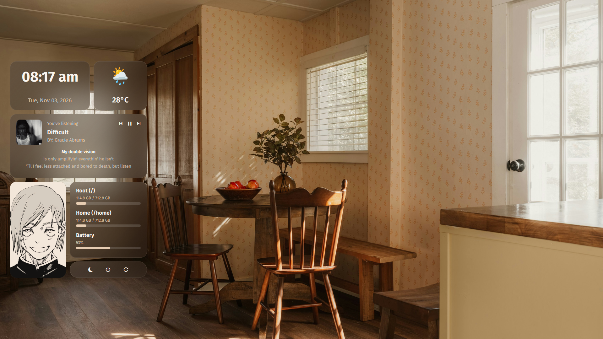

# Warm Frosted Glass Desktop Widgets for Quickshell & Hyprland

A modern **Warm Frosted Glass Bento Grid** desktop widget suite for Wayland/Hyprland, built natively with **Quickshell (Qt6 / QML)** and a lightweight Python background service.



---

## ✨ Features

- 🕒 **Clock & Date Card**: Large digital clock (`hh:mm ap`) and formatted full date (`ddd, MMM dd, yyyy`) via `Quickshell.SystemClock`.
- 🌦️ **Live Weather Card**: Real-time weather condition icon and temperature with 15-minute local caching.
- 🎵 **Unified Media Player & Real-Time Synced Lyrics Card**:
  - Live **MPRIS** integration (Spotify, YouTube/Brave/Firefox, VLC, Amberol, etc.).
  - Dynamic **Album Cover Art** with automatic fallback (`assets/album.jpg`).
  - Interactive playback controls (*Previous*, *Play/Pause*, *Next*).
  - **3-Line Real-Time Synced Lyrics** that automatically highlight the active line and collapse smoothly when no lyrics are available.
- 🖼️ **Character / Photo Poster Card**: Rounded `20px` portrait frame with a warm cream paper multiply tint (`#F3E7DA` + `#14F5E6D3`) so stark white manga/art backgrounds blend naturally with warm setups.
- 📊 **Linux System Monitor Card**:
  - **`Root (/)`** and **`Home (/home)`** partition usage & progress bars.
  - **`Battery`** percentage & progress bar.
- ⚡ **Power Controls Capsule**: Quick capsule buttons for *Suspend/Sleep*, *Power Off*, and *Reboot*.

---

## 🔍 Data Sources & How It Works

Every piece of data shown on the widget is fetched automatically without requiring paid API keys:

| Component | Source / Protocol | How It Works |
| :--- | :--- | :--- |
| **Album Cover Art** | `Quickshell.Services.Mpris` (`mpris:artUrl`) | Read directly in QML from the active media player's D-Bus MPRIS metadata (`activePlayer.trackArtUrl`). Falls back to `assets/album.jpg` when idle. |
| **Song Title & Artist** | `Quickshell.Services.Mpris` & `playerctl` | Read live from D-Bus MPRIS (`xesam:title` & `xesam:artist`), prioritizing whichever player is currently in the `Playing` state. |
| **Real-Time Synced Lyrics** | **[LRCLIB API](https://lrclib.net/)** (`https://lrclib.net/api/search`) + `playerctl position` | `stats.py` reads the active track title, artist, and playback timestamp (`position` in seconds) via `playerctl`, queries the open-source **LRCLIB** database for time-synced `.lrc` lyrics (`[mm:ss.xx]`), caches them locally in `/tmp/ml4w_desktop_lyrics_cache_v2.json`, and syncs the 3 visible lines to the current playback second. Works even for songs where Spotify hides or lacks lyrics, as well as YouTube playback! |
| **Weather & Temperature** | **[wttr.in](https://wttr.in/)** (`https://wttr.in/?format=%c+%t`) | Fetched by `stats.py` based on IP geolocation and cached for 15 minutes in `/tmp/ml4w_desktop_widgets_cache.json` to avoid rate limits. |
| **Disk Partitions (`Root /`, `Home /home`)** | Python `shutil.disk_usage()` | Queries native Linux filesystem usage for `/` and `~` (`/home`) every 2.5 seconds. |
| **Battery Status** | Linux `/sys/class/power_supply/BAT*` | Reads hardware battery capacity (`/capacity`) and charging status (`/status`) directly from `sysfs`. |
| **Frosted Glass Backdrop** | Hyprland `layerrule` + `ImageMagick` (`magick`) | Combines Hyprland compositor blur (`blur`, `ignorealpha 0.2`) with a vibrant Gaussian-blurred slice of the active wallpaper (`swww` / `awww` / `waypaper` / `ML4W`). |

---

## 📦 Requirements

Make sure the following packages are installed on your system:

1. **[Quickshell](https://quickshell.outfoxxed.me/)** (`qs`)
   - **Fedora**: `sudo dnf copr enable errornointernet/quickshell && sudo dnf install quickshell`
   - **Arch Linux**: `yay -S quickshell-git` or `paru -S quickshell-git`
2. **Python 3** (`python3`)
3. **playerctl** (required for media controls & timestamped lyrics sync)
   - **Fedora**: `sudo dnf install playerctl`
   - **Arch Linux**: `sudo pacman -S playerctl`
4. **ImageMagick** (`magick`, used for vibrant frosted wallpaper texture generation)
   - **Fedora**: `sudo dnf install ImageMagick`
   - **Arch Linux**: `sudo pacman -S imagemagick`
5. **Fonts**:
   - `Fira Sans` (UI text)
   - `FiraCode Nerd Font` (Media & Power icons)

---

## 🚀 Installation

### 1. Clone the repository
Clone directly into your `~/.config/quickshell/` folder:

```bash
git clone https://github.com/<your-username>/<repo-name>.git ~/.config/quickshell/DesktopWidgetsApp
```

### 2. Make the helper script executable
```bash
chmod +x ~/.config/quickshell/DesktopWidgetsApp/stats.py
```

### 3. Run the widget
```bash
qs -p ~/.config/quickshell/DesktopWidgetsApp
```

---

## 🌫️ Hyprland Blur & Autostart Configuration

### Option A: Standard Hyprland (`~/.config/hypr/hyprland.conf`)
Add these lines to your `hyprland.conf`:

```ini
# Autostart Desktop Widgets
exec-once = qs -p ~/.config/quickshell/DesktopWidgetsApp

# Frosted Glass Blur Settings
decoration {
    blur {
        enabled = true
        size = 10
        passes = 3
        new_optimizations = true
        xray = false
        vibrancy = 0.25
        brightness = 1.05
    }
}

# Blur only the cards and ignore transparent gaps
layerrule = blur, quickshell:desktop-widgets
layerrule = ignorealpha 0.2, quickshell:desktop-widgets
```

### Option B: ML4W Dotfiles (Hyprland Lua Config)
1. In `~/.config/hypr/conf/decorations/default.lua`, add:
   ```lua
   hl.layer_rule({
       name = "quickshell-desktop-widgets",
       match = { namespace = "quickshell:desktop-widgets" },
       blur = true,
       ignore_alpha = 0.2,
   })
   ```
2. In `~/.config/ml4w/scripts/ml4w-autostart`, add:
   ```bash
   qs -p $HOME/.config/quickshell/DesktopWidgetsApp &
   ```

---

## 🎨 Customization

### Changing the Character / Poster Image
Replace `assets/poster.jpg` with your own vertical image:

```bash
cp /path/to/your-image.jpg ~/.config/quickshell/DesktopWidgetsApp/assets/poster.jpg
```

### Safe Reload Command
To restart the widget cleanly after editing QML or replacing `assets/poster.jpg`:

```bash
kill $(pgrep -f 'quickshell/DesktopWidgetsApp') 2>/dev/null
qs -p ~/.config/quickshell/DesktopWidgetsApp &
```

---

## 📄 License
MIT License. Feel free to fork, customize, and share!
